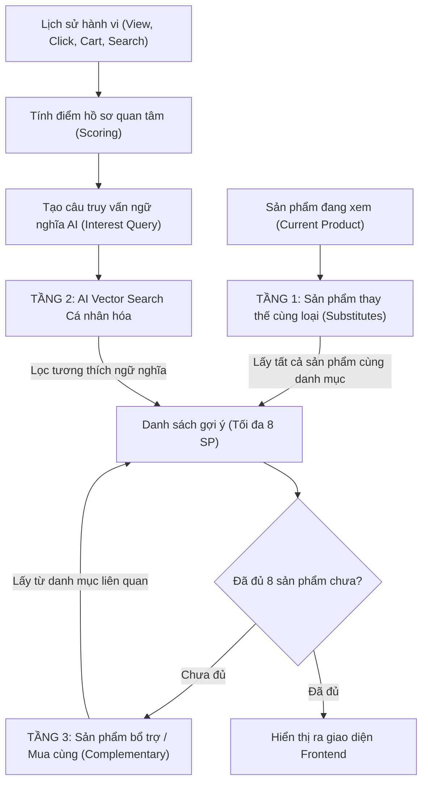

# TV5: Phân tích hành vi & Hệ thống Gợi ý Cá nhân hóa (Recommendation System)

Tài liệu đặc tả kiến trúc, thuật toán và cơ chế hoạt động của hệ thống gợi ý sản phẩm được phụ trách bởi **Thành viên 5**.

---

## 1. Tổng quan & Mục tiêu

Hệ thống gợi ý của eShop không sử dụng các giải thuật đơn giản (như random hay chỉ lấy theo ID), mà áp dụng mô hình **Hybrid Recommendation Engine** kết hợp 3 yếu tố:
1. **Rule-based Categorization**: Phân tích danh mục tương đương (Substitutes) và danh mục bổ trợ (Complementary).
2. **Behavioral Intent Scoring**: Khai thác dữ liệu theo vết (User Tracking) từ Thành viên 4 để lượng hóa độ quan tâm của khách hàng.
3. **Semantic Vector Search (Spring AI + MariaDB)**: Khai thác không gian vector 768 chiều từ Thành viên 2 để tìm kiếm độ tương đồng ngữ nghĩa.

---

## 2. Kiến trúc gợi ý 3 tầng (3-Tier Hybrid Architecture)

Khi khách hàng truy cập trang chi tiết sản phẩm (`/products/{id}`), hàm `findFor()` trong `ProductRecommendationService` sẽ điều phối luồng gợi ý:



### Chi tiết các tầng:

* **Tầng 1 (Cùng danh mục - Ưu tiên cao nhất)**:
  * Gom **tất cả** sản phẩm cùng loại còn hàng trong shop (loại trừ chính sản phẩm đang xem).
  * *Mục đích UX*: Khách hàng đang cân nhắc một chiếc chuột, việc đầu tiên họ muốn thấy là các mẫu chuột khác của cửa hàng để so sánh giá và tính năng.
* **Tầng 2 (AI Vector Search & Hành vi cá nhân hóa)**:
  * Sử dụng câu query giàu ngữ cảnh: `[Tên SP hiện tại] + [Tên danh mục] + [Top 2 từ khóa tìm kiếm gần nhất] + [Top 3 sản phẩm có điểm hành vi cao nhất]`.
  * Truy vấn qua `ProductVectorService.search()` với ngưỡng Cosine similarity `0.58`.
  * Lọc qua hàm `isCategoryCompatible()` để đảm bảo tính đúng đắn ngữ nghĩa.
* **Tầng 3 (Sản phẩm bổ trợ theo hệ sinh thái - Cross-Selling)**:
  * Nếu sau Tầng 1 và 2 chưa đủ 8 sản phẩm, hệ thống kích hoạt bảng tra cứu danh mục bổ trợ (`COMPLEMENTARY_CATEGORIES`).
  * Lấy từ 1 đến 2 sản phẩm tiêu biểu từ mỗi danh mục liên quan để làm phong phú lựa chọn mua sắm.

---

## 3. Ma trận trọng số hành vi (Behavioral Scoring Matrix)

Hệ thống ghi nhận hành vi trong vòng **30 ngày gần nhất** (tối đa 100 sự kiện) từ bảng `tracking_events`. Mỗi hành vi mang một trọng số phản ánh mức độ quan tâm (Purchase Intent):

| Hành vi (`TrackingEventType`) | Điểm số (`weight`) | Ý nghĩa nghiệp vụ |
| :--- | :---: | :--- |
| `PRODUCT_VIEW` | **1** | Lướt xem chi tiết sản phẩm (Mức độ quan tâm ban đầu) |
| `ADD_TO_CART_CLICK` | **2** | Nhấn nút "Thêm vào giỏ" trên giao diện (Ý định mua vừa) |
| `CART_UPDATE_CLICK` | **2** | Nhấn tăng/giảm số lượng trong giỏ hàng |
| `CART_UPDATE` | **3** | Server xác nhận cập nhật giỏ hàng thành công |
| `ADD_TO_CART` | **5** | Server xác nhận thêm sản phẩm vào giỏ thành công (Ý định mua cao) |
| `ORDER_PLACED` | **7** | Đơn hàng đã thanh toán thành công (Mức độ tin cậy tuyệt đối) |

* Điểm số của mỗi sản phẩm được tích lũy theo công thức:
  $$\text{Score}(P) = \sum_{e \in \text{Events}(P)} \text{weight}(e)$$
* Top 3 sản phẩm có điểm số $\text{Score}(P)$ cao nhất sẽ được đưa vào câu truy vấn ngữ nghĩa AI để ưu tiên gợi ý các sản phẩm cùng gu với khách hàng.

---

## 4. Bản đồ liên kết danh mục bổ trợ (Ecosystem Mapping)

Để phục vụ Tầng 3 (Cross-selling), hệ thống định nghĩa bảng ánh xạ danh mục phụ kiện đi kèm:

| Danh mục đang xem | Danh mục bổ trợ được ưu tiên gợi ý |
| :--- | :--- |
| **Bàn phím** | Chuột, Màn hình, Laptop, Tai nghe |
| **Chuột** | Bàn phím, Màn hình, Laptop, Tai nghe |
| **Laptop** | Chuột, Bàn phím, Màn hình, Tai nghe, Thiết bị lưu trữ |
| **Màn hình** | Laptop, Chuột, Bàn phím, Loa |
| **Điện thoại** | Tai nghe, Phụ kiện sạc, Đồng hồ thông minh, Máy tính bảng |
| **Máy tính bảng** | Bàn phím, Tai nghe, Phụ kiện sạc, Điện thoại |
| **Tai nghe** | Loa, Điện thoại, Laptop, Đồng hồ thông minh |
| **Máy ảnh** | Thiết bị lưu trữ (thẻ nhớ/ổ cứng), Phụ kiện sạc |
| **Gia dụng thông minh** | Các thiết bị gia dụng thông minh khác |

### Bộ lọc cô lập bảo vệ (Category Compatibility Guard):
Hàm `isCategoryCompatible()` kiểm tra:
* Nhóm **Gia dụng thông minh** (Robot hút bụi, Nồi chiên không dầu, Máy lọc không khí) được cách ly 100% với nhóm **Thiết bị công nghệ / IT** (Bàn phím, Chuột, Laptop, Điện thoại...).
* Tránh triệt để tình trạng người dùng xem Bàn phím nhưng lại bị gợi ý Nồi chiên không dầu.

---

## 5. Cơ chế cập nhật thời gian thực (Real-time Dynamic Update)

1. Khi khách hàng click thêm vào giỏ hoặc xem sản phẩm, `tracking.js` tự động gửi sự kiện về server.
2. Ngay sau đó, hàm `refreshRecommendations()` trong `tracking.js` gửi request ngầm (AJAX) tới:
   ```http
   GET /tracking/recommendations?productId=22&sessionId=...
   ```
3. `TrackingRecommendationController` tính toán lại danh sách và trả về Thymeleaf HTML fragment `shop/detail :: recommendations`.
4. Trình duyệt cập nhật lại khối giao diện mà **không cần tải lại (F5) toàn bộ trang**, tạo cảm giác mượt mà và cá nhân hóa tức thì.

---

## 6. Bộ câu hỏi chuẩn bị khi bảo vệ / vấn đáp (Q&A)

**Q1: Hệ thống gợi ý này thuộc loại nào trong lý thuyết máy học?**
> *Trả lời*: Hệ thống áp dụng mô hình **Hybrid Recommendation System**, kết hợp giữa:
> - **Content-based Filtering** (thông qua AI Vector Search tính khoảng cách Cosine trên đặc trưng văn bản sản phẩm).
> - **Rule-based & Ecosystem Filtering** (gợi ý theo danh mục cùng loại và phụ kiện đi kèm).
> - **Implicit Feedback Behavior Scoring** (phân tích hành vi ngầm như xem, click, thêm giỏ, đặt hàng để cá nhân hóa).

**Q2: Nếu là khách vãng lai (Guest) chưa đăng nhập thì hệ thống gợi ý ra sao?**
> *Trả lời*: Hệ thống vẫn cá nhân hóa bình thường nhờ cơ chế `sessionId` (UUID v4) lưu trong `sessionStorage` của trình duyệt. Mọi hành vi trong phiên của khách vãng lai vẫn được tích lũy điểm số để gợi ý. Khi người dùng đăng nhập, hệ thống sẽ kết hợp cả lịch sử tài khoản (`userId`) lâu dài.

**Q3: Tại sao lại cần ngưỡng Cosine Similarity là 0.58?**
> *Trả lời*: Với mô hình `gemini-embedding-001`, ngưỡng 0.58 là "điểm cân bằng vàng":
> - Nếu đặt quá cao (ví dụ 0.72): Hệ thống quá khắt khe, chỉ tìm thấy sản phẩm y hệt, bỏ qua các sản phẩm phụ kiện liên quan.
> - Nếu đặt quá thấp (ví dụ 0.45): Xuất hiện nhiễu ngữ nghĩa (sản phẩm không liên quan bị lọt vào).
> - Kết hợp với bộ lọc `isCategoryCompatible()`, ngưỡng 0.58 vừa đảm bảo độ đa dạng vừa ngăn chặn hoàn toàn việc nhầm lẫn danh mục.
